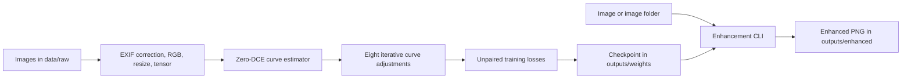

# Low-Light Image Enhancement

[](https://www.python.org/)
[](https://pytorch.org/)
[](#problem-statement-and-objectives)

An unpaired low-light image enhancement project using a Zero-DCE style curve-estimation network. It trains on low-light images without paired bright targets and provides command-line image enhancement.

> **Status:** No dataset, trained weights, benchmark results, web service, or software license is included in the supplied project. Details requiring those artifacts are identified below rather than estimated.

## Table of contents

- [Problem statement and objectives](#problem-statement-and-objectives)
- [Dataset overview](#dataset-overview)
- [Tech stack and requirements](#tech-stack-and-requirements)
- [Pipeline architecture](#pipeline-architecture)
- [Getting started](#getting-started)
- [Usage](#usage)
- [Performance and evaluation](#performance-and-evaluation)
- [Project structure](#project-structure)
- [License and acknowledgments](#license-and-acknowledgments)

## Project structure

```text
.
├── data/raw/                   # Add training images here (not tracked)
├── notebooks/                  # Exploration notebooks
├── outputs/
│   ├── enhanced/               # Generated enhanced images (not tracked)
│   └── weights/                # Model checkpoints (not tracked)
├── presentations/              # Project slide decks
├── references/                 # Papers and review documents
├── scripts/                    # Training and inference entry points
├── src/low_light_enhancement/  # Reusable model, dataset, and losses
└── pyproject.toml
```

### Quick setup

Python 3.10 or newer, PyTorch, NumPy, and Pillow are required. From the repository root, create a fresh virtual environment and install the project:

```powershell
py -m venv .venv
.\.venv\Scripts\Activate.ps1
python -m pip install --upgrade pip
python -m pip install -e .
```

The workspace may contain an older `venv/` directory. The commands above create a separate `.venv/` environment so the project does not depend on that older environment. If PowerShell activation is blocked, run `\.venv\Scripts\python.exe -m pip install -e .` and use `\.venv\Scripts\python.exe` to run the scripts.

Place unpaired low-light images (`jpg`, `jpeg`, `png`, `bmp`, `tif`, `tiff`, or `webp`) directly in `data/raw/`. This folder is empty initially, so add images before training. Raw data is excluded from Git.

### Quick training command

```powershell
python scripts/train.py --data data/raw --epochs 10 --batch-size 8
```

Checkpoints are saved under `outputs/weights/` by default. Training uses spatial consistency, exposure, color constancy, and curve smoothness losses. Run `python scripts/train.py --help` to see all options.

### Quick inference commands

```powershell
python scripts/enhance.py path/to/image.jpg --checkpoint outputs/weights/zerodce_epoch_010.pth
python scripts/enhance.py path/to/image_folder --checkpoint outputs/weights/zerodce_epoch_010.pth
```

Enhanced PNG files are written to `outputs/enhanced/`. Use `python scripts/enhance.py --help` to see options. Select a checkpoint filename that exists in your `outputs/weights/` folder.

### Notebook

Open `notebooks/low_light_enhancement.ipynb` for a minimal example using the project package. It uses the local model and does not download an unrelated hosted Keras model.

## References and presentations

Research PDFs are in `references/`; the two supplied slide decks are retained in `presentations/`, with the later modified copy identified by its recorded modification date.

## Problem statement and objectives

Low-light and unevenly illuminated images can hide details and distort color and contrast. This project uses a Zero-DCE style curve estimator to learn pixel-wise adjustments from unpaired low-light images, so a bright reference image is not required for each training example.

The objectives are to train the curve estimator with spatial consistency, exposure, color constancy, and curve smoothness losses, save reusable checkpoints, and enhance individual images or folders through a simple CLI. No measured quality, speed, or business-impact results are available yet.

For a future evaluation, use PSNR and SSIM when aligned bright references are available. For unpaired data, choose and document appropriate no-reference quality metrics and include human review. Record inference latency, image size, batch size, hardware, and software versions.

## Dataset overview

| Property | Current status |
| --- | --- |
| Source and link | Not supplied; add the dataset source and access link before publishing |
| Images supplied | 0; `data/raw/` is empty |
| Expected location | `data/raw/` |
| Training setup | Unpaired image-folder training |
| Target variable | None; model output is 24 adjustment maps, not a class label |
| Supported formats | JPG, JPEG, PNG, BMP, TIF, TIFF, WebP |
| Preprocessing | EXIF orientation correction, RGB conversion, resize, float tensor in `[0, 1]` |

Place images directly in `data/raw/`; nested folders are not scanned. Use data you are authorized to use, and document its license, source, image count, and any validation split. Raw images are excluded from Git.

## Tech stack and requirements

- Python 3.10 or later
- PyTorch 2.0 or later for the model and data loading
- NumPy and Pillow for image conversion and preprocessing
- CPU execution is supported; a compatible CUDA-enabled PyTorch installation and NVIDIA GPU are recommended for faster training

The repository does not currently use Scikit-learn, MLflow, Docker, FastAPI, Flask, or Streamlit. No minimum GPU memory requirement has been measured. See the setup commands above; dependencies are declared in `pyproject.toml`. For a CUDA installation, select a PyTorch build compatible with your driver and CUDA runtime using the [official PyTorch installation guide](https://pytorch.org/get-started/locally/).

## Pipeline architecture



Preprocessing is part of the dataset loader. `scripts/train.py` trains and saves a checkpoint; `scripts/enhance.py` applies a checkpoint to an image or a folder. Separate ETL, evaluation, hyperparameter tuning, and deployment components are not implemented.

## Getting started

Run setup commands from the repository root. Create a fresh environment because the existing `venv/` may refer to a missing or incompatible Python installation:

```powershell
py -3.10 -m venv .venv
.\.venv\Scripts\Activate.ps1
python -m pip install --upgrade pip
python -m pip install -e .
```

Conda alternative:

```bash
conda create -n low-light python=3.10 -y
conda activate low-light
python -m pip install -e .
```

Docker is not configured. CPU inference and training are supported; GPU use depends on installing the matching CUDA-enabled PyTorch build.

## Usage

### Data preparation

Copy supported training images directly into `data/raw/`. There is no data download or standalone preprocessing script.

### Train

```bash
python scripts/train.py --data data/raw --output outputs/weights --epochs 10 --batch-size 8
python scripts/train.py --help
```

Defaults include 256 × 256 input images and automatic CUDA/CPU selection. A checkpoint is saved after every epoch. Training will stop with a clear error while the data directory has no images.

### Evaluation

No evaluation or test script is present, and no validation scores are available. Evaluate checkpoints on a documented held-out set before drawing conclusions or publishing metrics.

### Inference

```bash
python scripts/enhance.py path/to/image.jpg --checkpoint outputs/weights/zerodce_epoch_010.pth
python scripts/enhance.py path/to/image_folder --checkpoint outputs/weights/zerodce_epoch_010.pth
python scripts/enhance.py --help
```

Output PNG files are written to `outputs/enhanced/`. No web app or API is included.

## Performance and evaluation

No model comparison has been run on a documented dataset. These values are intentionally reported as unavailable rather than fabricated:

| Model | PSNR ↑ | SSIM ↑ | No-reference quality | Inference latency | Evaluation set |
| --- | ---: | ---: | ---: | ---: | --- |
| Identity / input baseline | Not measured | Not measured | Not measured | Not measured | Not supplied |
| Zero-DCE project model | Not measured | Not measured | Not measured | Not measured | Not supplied |

For reproducible results, add the dataset and split, checkpoint, metric implementation, image resolution, hardware, software versions, and latency measurement method. Confusion matrix and ROC-AUC are classification metrics and do not apply to this enhancement task. The current scripts do not generate comparison visualizations.

## License and acknowledgments

No software license is declared in this repository. Add a `LICENSE` file before redistribution and check the redistribution terms for datasets and the supplied documents. The project uses the Zero-DCE style of curve-based low-light enhancement and is implemented with PyTorch, NumPy, and Pillow. Add complete paper citations and dataset attribution when the chosen source and dataset are confirmed.
# Low-Light-Image-Enancement

# Low-Light-Image-Enancement


